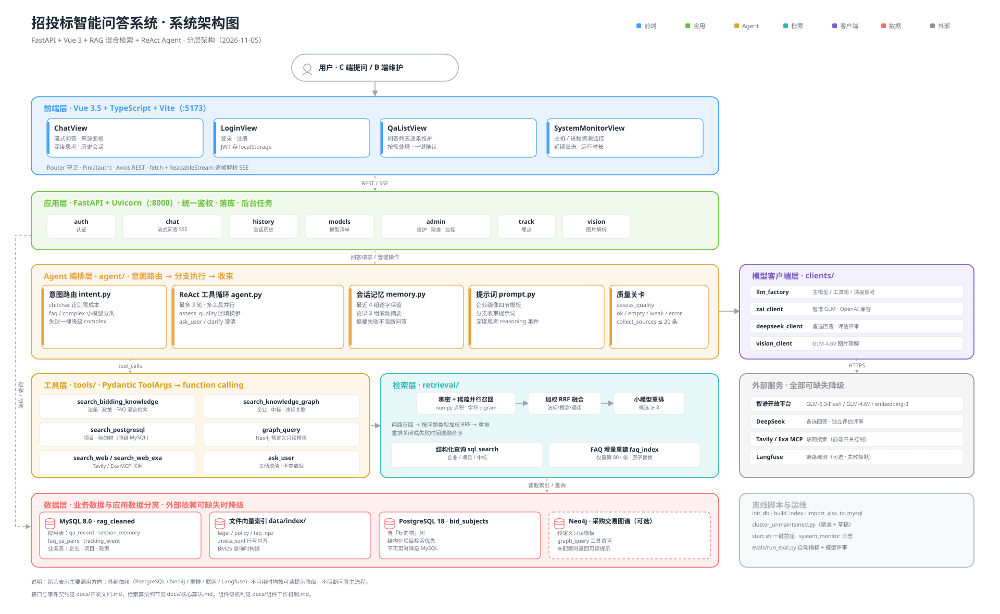
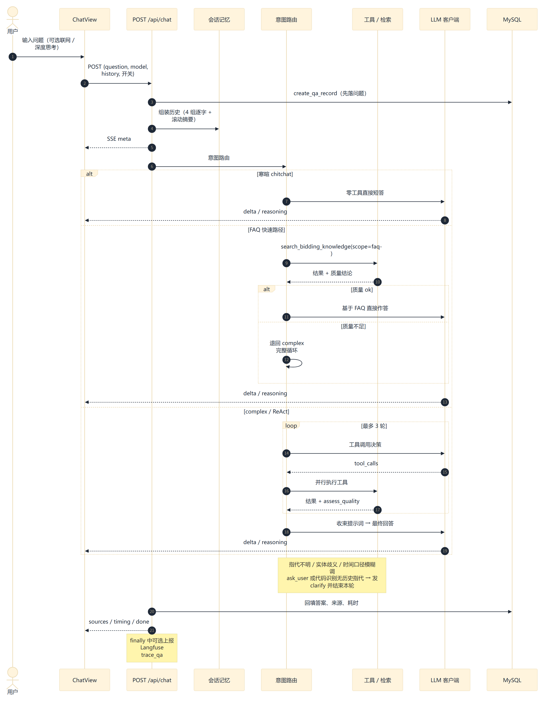
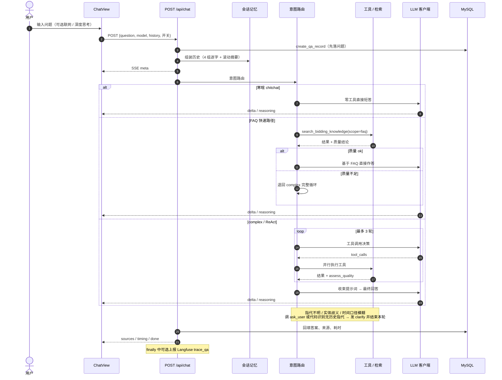
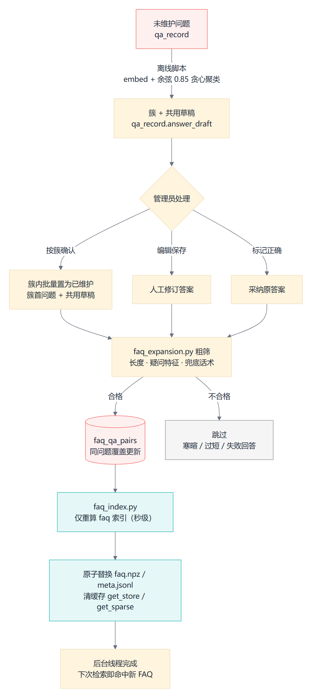
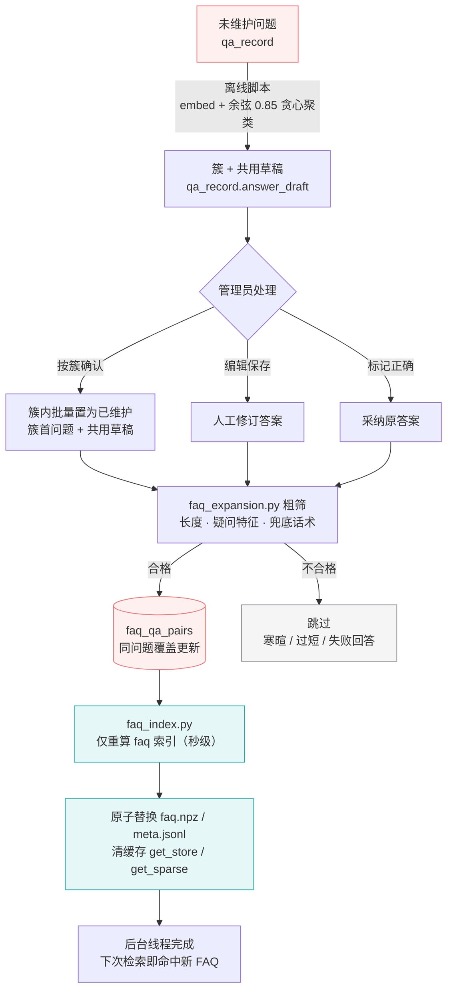
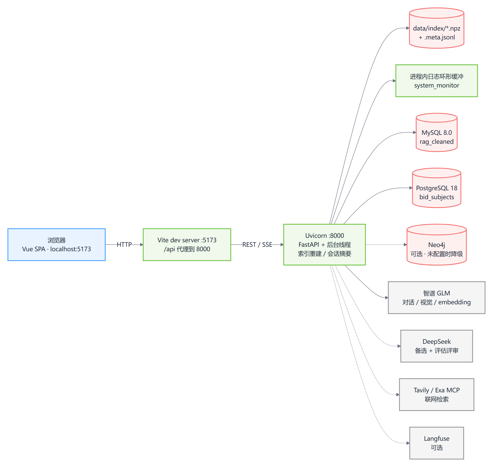
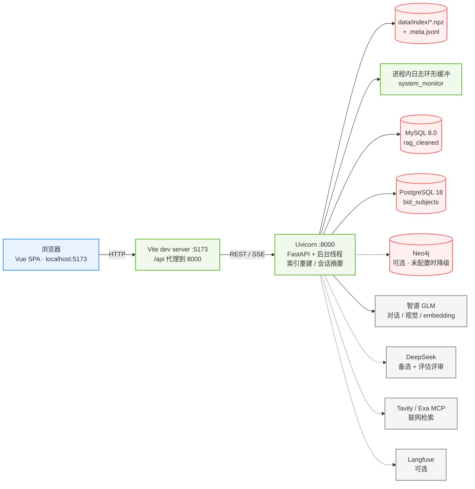

# 系统架构图

> 依据仓库当前实现整理（2026-11-05）。第 1 节总览为手工排版的 SVG（同时提供 PNG），第 2–4 节使用 **Mermaid v11** 语法，可在 VSCode（Mermaid 插件）、Typora、<https://mermaid.live> 查看。
> 图片文件在 `docs/assets/`。分层与模块细节见 `开发文档.md`，检索算法细节见 `核心算法.md`。

**配色图例**：🔵 前端 · 🟢 应用层 · 🟠 Agent 层 · 🟡 工具层 · 🩵 检索层 · 🟣 模型客户端 · 🔴 数据层 · ⚪ 外部服务

---

## 1. 分层架构总览

> 矢量版 `assets/architecture-overview.svg`，位图版 `assets/architecture-overview.png`（适合插入 PPT）。

### 分层职责

| 层 | 职责 | 关键文件 / 组件 |
| --- | --- | --- |
| 前端层 | 登录鉴权、流式问答渲染、来源与耗时展示、B 端问答维护与监控 | `frontend/src/views/`、`api/chat.ts`、`router/index.ts` |
| 应用层 | HTTP/SSE 入口、参数校验、落库、权限兜底、后台任务编排 | `src/rag_agent/api/` |
| Agent 编排层 | 意图路由、ReAct 循环、澄清、会话记忆、提示词与收束 | `agent/intent.py`、`agent/agent.py`、`agent/memory.py`、`agent/prompt.py` |
| 工具层 | 把检索/查询能力包装成模型可调用的 function calling 工具 | `tools/rag_tools.py`、`tools/graph_tools.py`、`tools/mcp_tools.py` |
| 检索层 | 稠密 + 稀疏混合召回、加权融合、重排、结构化查询、FAQ 索引重建 | `retrieval/` |
| 模型客户端层 | 统一 OpenAI 兼容客户端，屏蔽智谱 / DeepSeek / 视觉差异（embedding 在 `rag_agent/llm.py`） | `clients/llm_factory.py` 等 |
| 数据层 | 业务与应用数据、文件型向量索引、（可选）图数据库 | MySQL、`data/index/`、PostgreSQL、Neo4j |
| 外部服务 | 大模型、联网检索、链路观测 | 智谱、DeepSeek、Tavily、Exa、Langfuse |

---

## 2. C 端问答主链路

**分支判据**

- `chitchat`：正则零成本判定，不查数据。
- `faq`：只查一次 FAQ；`assess_quality == ok` 才走快速路径，否则退回完整循环。
- `complex`：最多 3 轮 ReAct，多工具并行；质量不达标时把结论回填给模型驱动换参或换工具。
- 澄清：模型调用 `ask_user`，或代码识别出无历史上下文的「那家公司 / 那个项目」时直接发 `clarify`，本轮不生成回答。

---

## 3. B 端维护飞轮（FAQ 自动扩充）

**设计约束**

- 聚类与起草是离线脚本（几百条要跑几十分钟），不进同步接口；接口只读聚类结果。
- 簇没有独立表：同簇记录共用同一份 `answer_draft`，簇 id 取 `MIN(qa_record.id)`。
- 起草只能用 `question + 来源标题`，prompt 明确「不确定的细节不写」，不虚构项目数据。
- FAQ 写入与索引重建分离：先落 `faq_qa_pairs`，后台线程重建失败也不影响管理端操作，下次确认会再次触发。

---

## 4. 部署与运行形态

**现状说明**

- 当前是单机开发形态：`start.sh` 同时拉起 Vite 与 Uvicorn，生产所需的 Nginx 同域部署、进程守护、健康检查聚合尚未落地。
- 外部依赖全部按「可缺失」设计：Neo4j / PostgreSQL / 重排 / 联网 / Langfuse 任一不可用时返回可读提示并降级，不阻断问答主流程。
- `.env` 由 `config.get_settings()` 进程级缓存，改完必须重启后端。

---

## 5. 关键取舍

1. **不引 LangChain / LlamaIndex / 向量数据库**：工具层用 Pydantic 自建 Schema，检索用 numpy 点积 + 文件型索引，链路短、可调试、部署零额外服务。
2. **意图路由前置**：寒暄走正则、FAQ 走单次检索，只有真正复杂的问题才进 3 轮工具循环，省 token 也省延迟。
3. **质量关卡贯穿**：`assess_quality` 的 `ok / empty / weak / error` 同时驱动 FAQ 快速路径与 ReAct 收束，避免「检索为空还硬答」。
4. **索引与业务库分离**：FAQ 增量重建只重算 80+ 条向量，秒级完成；原子替换 + 清缓存保证读写一致。
5. **管理端反哺检索**：编辑 / 标记正确 / 按簇确认都会沉淀 FAQ，系统越用越准。
