# 组件工作机制图解

> 全部使用 **Mermaid v11** 语法（`flowchart` / `sequenceDiagram` / `classDiagram` / `erDiagram`）。
> 节点以圆角矩形为主，数据库用圆柱体，用户/终止用圆形；**每个子图独立配色**。
>
> **配色图例**：🔵 前端 · 🟢 API 应用层 · 🟠 Agent 层 · 🟣 客户端层 · 🩵 检索层 · 🔴 数据层 · ⚪ 外部服务
>
> 推荐查看器：VSCode（Markdown Preview Mermaid Support 插件）、Typora、<https://mermaid.live>

---

## 1. 系统总览

分层架构总览（前端 / 应用 / Agent / 工具 / 检索 / 数据 / 外部服务）已独立成图，见 **[系统架构图.md](系统架构图.md)**。本文从第 2 节起聚焦各组件内部机制。

---

## 2. 前端：ChatView 问答页机制

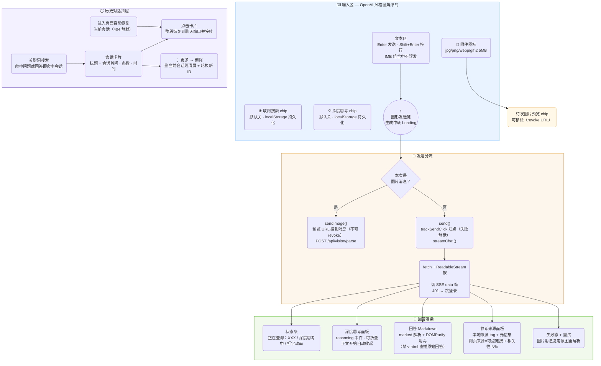

---

## 3. 问答主链路（SSE 时序）

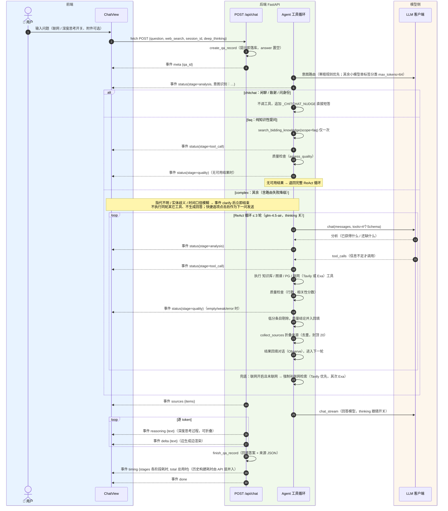

---

## 4. Agent 工具循环与联网搜索（双源必查）

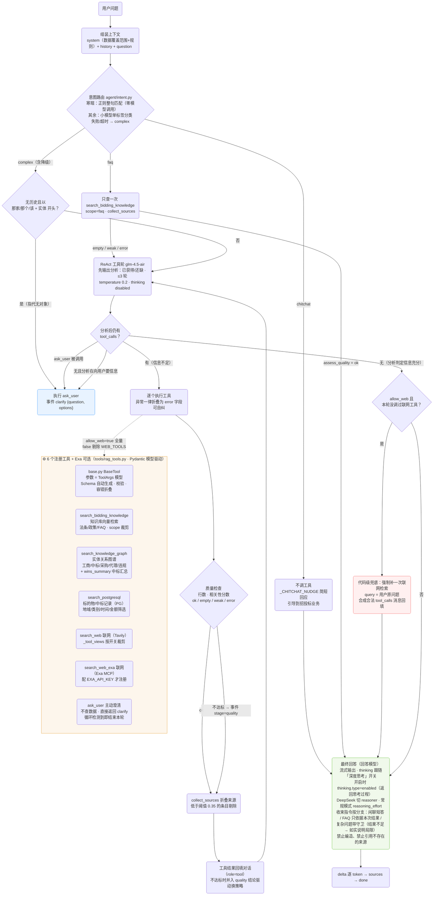

> **意图路由前置**（`agent/intent.py`）：进工具循环前判定一次。寒暄用正则整句匹配（零模型调用），
> 其余用工具轮小模型单标签分类；`chitchat` 不调工具、`faq` 只查一次 FAQ 后直接作答、`complex` 走完整循环。
> 分类失败/超时降级为 `complex`；FAQ 检索无可用结果时也退回完整循环，避免误判后直接判死。
>
> **主动澄清**（`tools/ask_user.py` + 提示词规则 5）：指代不明（那家公司/那个项目）、实体歧义
> （同名企业、简称可指多家）、时间口径模糊（无法推断"最近"范围）时先反问，不猜对象检索。
> 无历史且问题以未解析指代开头时由代码直接构造 ask_user 结果兜底；模型调用 ask_user，
> 或把澄清写进分析文本却忘了调工具时，都转成 `clarify` 事件并立即结束本轮——不执行其它工具、
> 不进入生成。前端渲染成带快捷选项的气泡，点击选项即作为下一问发送；没有真实候选时选项为空，
> 禁止编造企业名/项目名。
>
> **企业画像**（提示词规则 6 + 收束模板）：识别"某公司实力/背景/靠谱吗"类问题后，
> search_knowledge_graph 以 relation=all 一次取回工商/中标/采购/代理/违规五类素材，
> wins 分支另附全量中标汇总（总次数/总金额/主要采购人 TOP3）；最终回答固定按
> 「概况 / 经营状况 / 中标表现 / 风险提示」四节输出，某节无数据时写明
> "本次未检索到 XX 数据"，不得跳过该节或用记忆补全，也不给"靠谱/不靠谱"主观评级。
>
> **双源必查规则**（提示词规则 4）：联网开关开启 → 必查本地 + 必查联网，综合两类结果作答；
> 关闭 → 仅本地，查不到如实说明。强制兜底保证"必联网"，即使模型偷懒也会被补上。
>
> **结果质量关卡**：每个工具执行后按行数 + 相关性分数判定 ok / empty / weak / error（阈值 0.35）。
> 不达标 → `stage=quality` 事件通知前端，质量结论回填给模型驱动下一轮换关键词/换工具/换信息源；
> 低分条目不进"参考来源"；调过工具但全程无可用结果 → 收束时如实告知用户并给调整建议；
> 收束指令始终带守卫：禁止编造数据、禁止引用检索结果中不存在的来源。

---

## 5. 客户端层：多厂商 LLM 接入

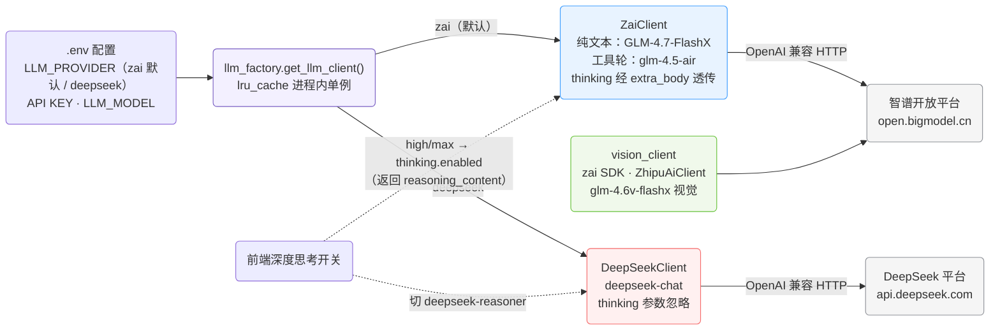

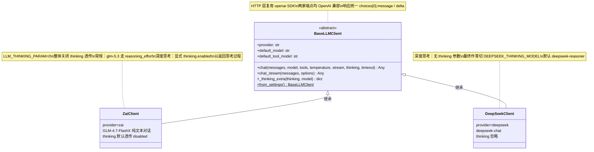

---

## 6. 检索层：知识库 / 知识图谱 / PostgreSQL

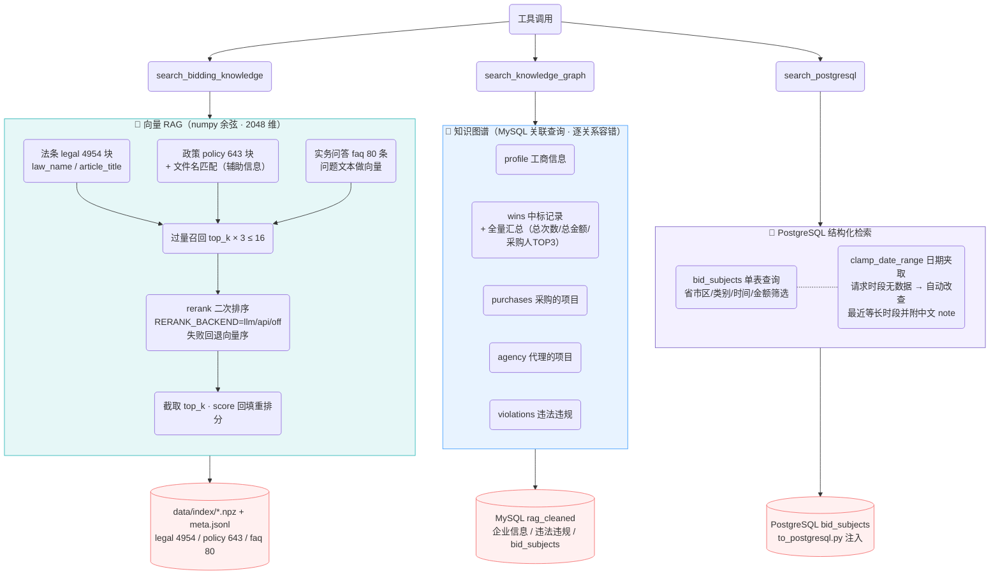

---

## 7. 数据模型与对话历史持久化

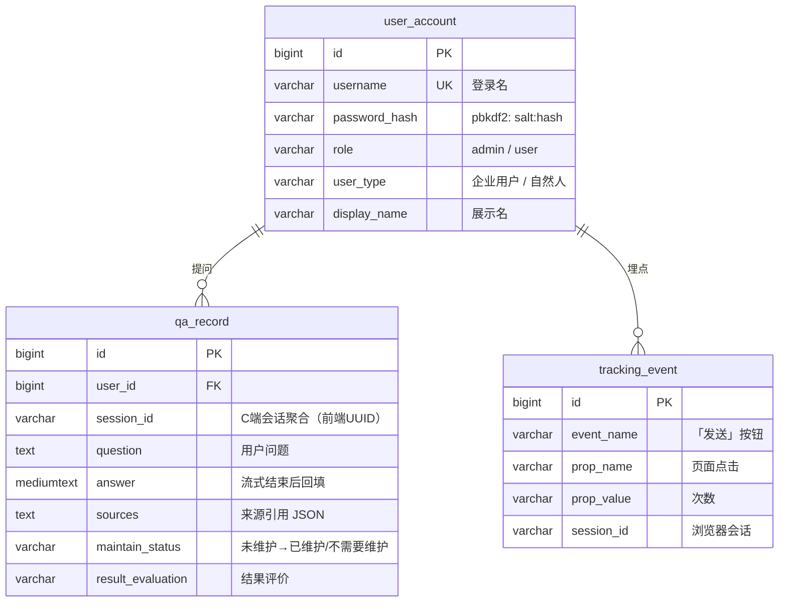

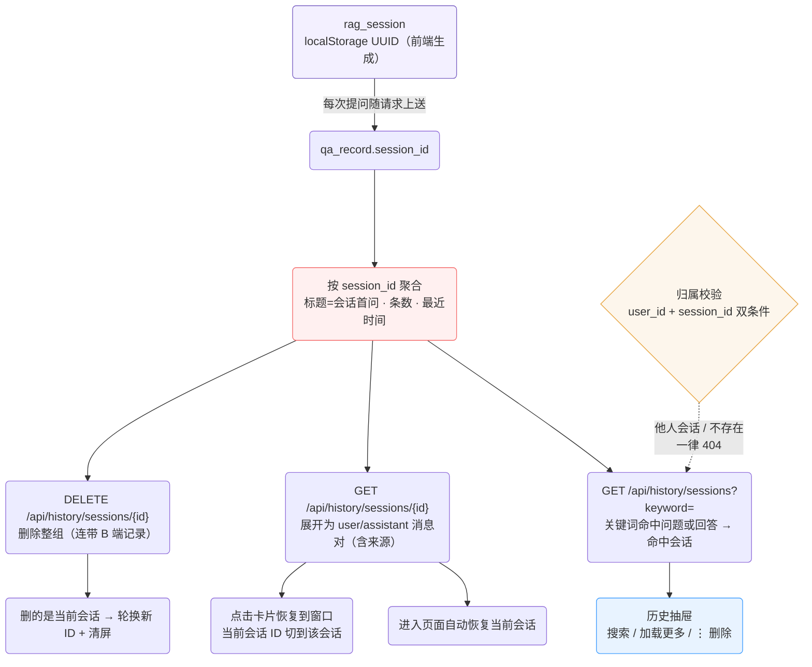

---

## 8. 支撑链路

### 8.1 图片解析（视觉理解）

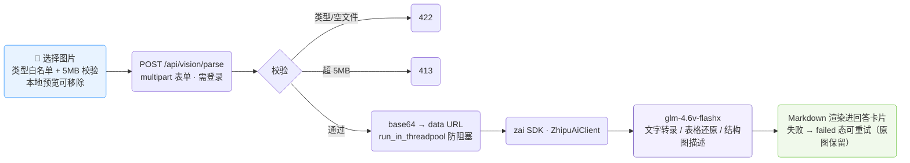

### 8.2 认证与安全

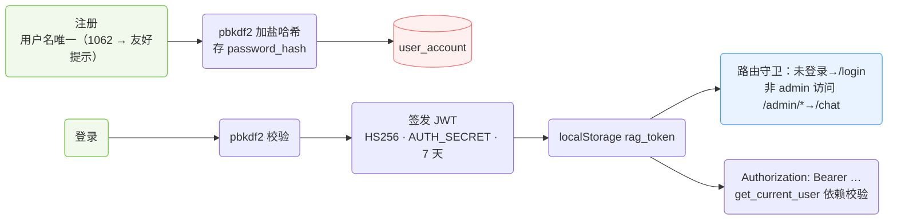

### 8.3 埋点与配置

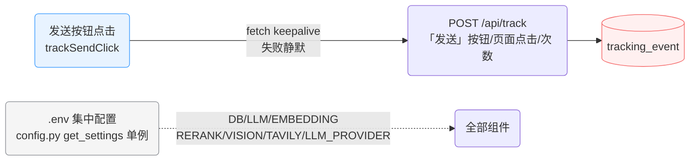

### 8.4 系统监控

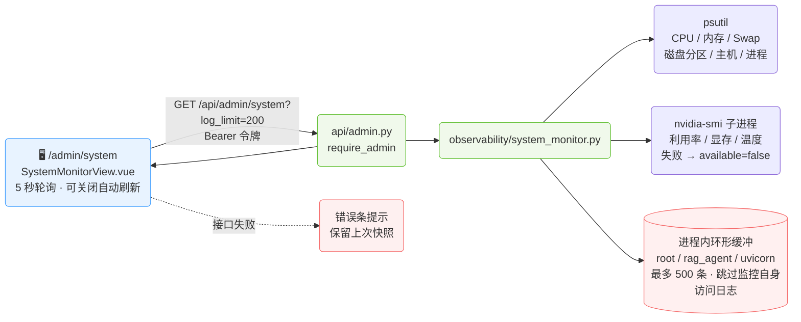

### 8.5 未维护问题聚类 + 草稿（B 端批量消化）

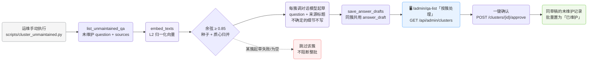

要点：`qa_record` 只存来源标题、没有完整检索结果，所以起草 prompt 强制「不确定的细节不写、不假装读过项目数据」；簇身份 = 草稿内容相同（不新增簇表），簇 ID 取簇内最小 `qa_record.id`，脚本重跑后 id 稳定。`--limit N` 只跑最近 N 条、`--dry-run` 只聚类不写库，便于冒烟。

### 8.6 FAQ 自动扩充闭环

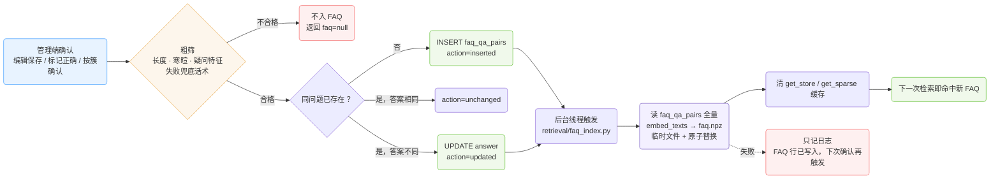

要点：三个确认动作都以管理员内容为准（编辑保存用新 `answer`；标记正确/按簇确认优先用聚类草稿）；按簇确认只沉淀一条（簇代表问题 + 共用草稿），避免近重复问题塞满 FAQ。索引重建只重算 faq 一个库（~80 条，秒级），与 `scripts/build_index.py` 的 faq 分支共用 `retrieval/faq_index.py`；重建失败不影响 FAQ 行写入，下次确认会再次触发。
